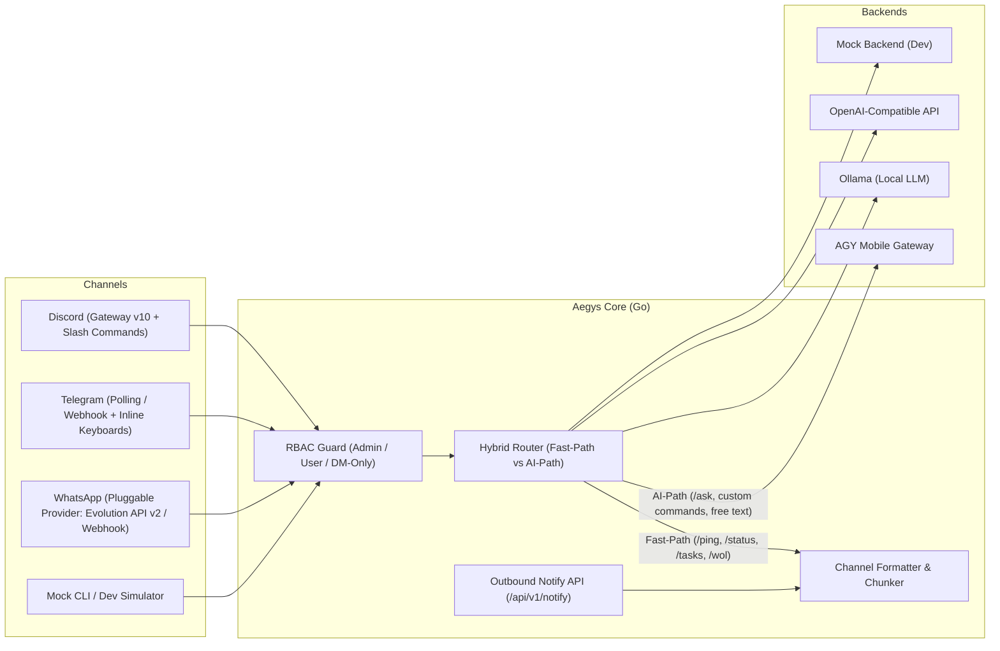

# Aegys Bot

**Aegys Bot** is an open-source, multi-channel personal operations and AI assistant written in pure Go (zero CGO). It unifies **Discord**, **Telegram**, and **WhatsApp** under a single hybrid command router with strict Role-Based Access Control (RBAC), pluggable messaging drivers, and pluggable AI backends.

---

## Architecture



---

## Key Features

- **Multi-Channel Native Support:**
  - **Discord:** Gateway WebSocket v10 client with automatic slash command sync (`/ping`, `/status`, `/tasks`, `/wol`, `/reset`, `/ask`) and DM/channel chunking.
  - **Telegram:** Supports both zero-config **long-polling** and production **webhooks**, plus Inline Keyboards for task execution.
  - **WhatsApp (Provider Abstraction):** Ships with an **Evolution API v2** driver (default instance `aegys`) and a **Generic Webhook** driver so contributors can plug in Cloud API proxies or WPPConnect without touching the core.
- **Hybrid Routing (`Fast-Path` vs `AI-Path`):**
  - Deterministic system commands execute in milliseconds at zero LLM token cost.
  - Free-text prompts, `/ask`, and declarative custom commands (`config/commands.example.json`) route to your chosen AI backend (`agy-gateway`, `ollama`, `openai`, or `mock`).
- **2-Tier RBAC + Outbound Notify API:**
  - `ADMIN_USER_IDS`: Full access (`/status`, `/tasks`, `/run`, `/wol`, AI).
  - `ALLOWED_USER_IDS`: Safe commands (`/ping`, `/whoami`, `/reset`) and AI chat.
  - `POST /api/v1/notify`: Authenticated outbound notification endpoint for scripts, homelab monitors, and CI pipelines — recipients receive alerts without gaining inbound command access.
- **Zero-Token Developer Sandbox (`--dev-cli`):**
  - Contributors can clone and test RBAC, commands, and channel formatting in seconds with zero API keys or external servers.

---

## Quickstart (30 Seconds — No Tokens Required)

```bash
git clone https://github.com/AetherCore-Works/aegys-bot.git
cd aegys-bot
go run ./cmd/aegys --dev-cli
```

Inside the interactive sandbox:

```text
[mock:admin dm=true]> /help
[mock:admin dm=true]> /tasks
[mock:admin dm=true]> :as user
[mock:user dm=true]> /tasks          # Blocked by RBAC (admin only)
[mock:user dm=true]> :platform whatsapp
[whatsapp:user dm=true]> /summarize Release notes ready
```

---

## Running in Production (Docker Compose)

1. Copy `.env.example` to `.env` and configure only the channels and AI backend you need:

```bash
cp .env.example .env
```

2. Start Aegys:

```bash
docker compose up -d --build
```

3. Verify health:

```bash
curl http://127.0.0.1:8090/healthz
```

---

## API Endpoints

| Method | Path | Auth | Description |
| :--- | :--- | :--- | :--- |
| `GET` | `/healthz` | None | Health status, active AI backend, and enabled channels |
| `POST` | `/api/v1/notify` | `Bearer <AEGYS_API_SECRET>` | Send outbound notifications (`platform`, `recipient`, `text`) |
| `POST` | `/webhooks/whatsapp` | `X-Webhook-Secret` (optional) | Inbound WhatsApp webhook for Evolution API v2 or generic driver |
| `POST` | `/webhooks/telegram` | `X-Telegram-Bot-Api-Secret-Token` | Inbound Telegram webhook (when `TELEGRAM_MODE=webhook`) |
| `POST` | `/api/v1/dev/simulate` | Enabled when `ENABLE_MOCK=true` | Simulate inbound messages and inspect formatted channel output |

---

## Contributing

We welcome contributions! See [CONTRIBUTING.md](CONTRIBUTING.md) for guidelines on adding new channel adapters, WhatsApp providers, AI backends, or Fast-Path commands.

## License

Released under the [MIT License](LICENSE).
